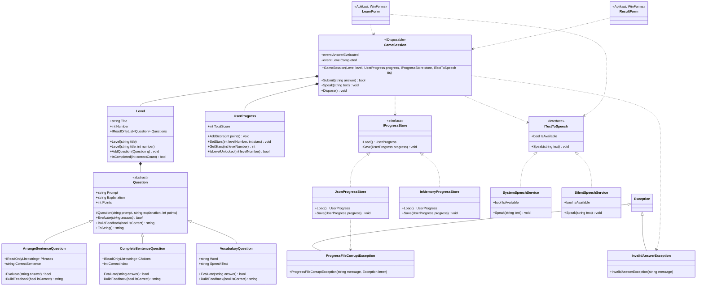

# Phrasia

> Baca `SOAL.md` dulu. Proposal dan Laporan Akhir dikumpulkan di Classroom (bukan di repo). Ganti semua `TULIS_DI_SINI` di berkas ini dan berkas catatan lain. Berkas yang masih memuat
> `TULIS_DI_SINI` dianggap belum diisi.

## Tautan

- Paket rilis (GitHub Releases, zip yang dapat langsung dijalankan): TULIS_DI_SINI

## Kelompok

| Nama | NRP | Akun GitHub |
|---|---|---|
| Galih Arsandy Tawakal | 5025251074 | Gandywa |
| Khen Patra Yabes Sianipar | 5025251227 | Arkeinea |
| Affan Rafi Habibie | 5025251265 | affnrafih |

## Ide dan pembeda

- Ide dalam satu kalimat: Program pembelajaran Bahasa Inggris dengan dasar Listening/Mendengarkan.
- Apa yang membuatnya berbeda dari aplikasi serupa lain: Menggunakan metode Listening/Mendengarkan agar pengguna dapat membiasakan diri dengan mendengarkan bahasa inggris.

## Untuk guru

- Mata pelajaran dan jenjang: Bahasa Inggris
- Tujuan belajar: TULIS_DI_SINI
- Cakupan materi (dan sumber rujukannya): TULIS_DI_SINI
- Cara menjalankan dan memakai: TULIS_DI_SINI

## Rancangan

Jelaskan singkat arsitektur aplikasi dan pola desain yang dipakai (mis. Strategy untuk penilaian). Tempel diagram kelas (Mermaid)
yang cocok dengan kode.



Alur satu soal: siswa menjawab di `LearnForm`, form memanggil `GameSession.Submit()`, sesi menilai lewat `Question.Evaluate()`, lalu memicu event `AnswerEvaluated`. Form itu memperbarui umpan balik dan skor. Saat level selesai, event `LevelCompleted` ditangkap `ResultForm` untuk menampilkan skor dan bintang.

**Polimorfisme dan Template Method pada soal**   
`Question` adalah abstract class dengan `Evaluate()` (abstract) dan `BuildFeedback()` (virtual). Tiga jenis soal (`ArrangeSentenceQuestion`, `CompleteSentenceQuestion`, `VocabularyQuestion`) mengisi aturan penilaiannya sendiri. `GameSession` menilai semua soal lewat satu pemanggilan tanpa mengecek tipe, sehingga jenis soal baru bisa ditambah tanpa mengubah kelas lain.

**Strategy untuk penyimpanan dan suara**  
`IProgressStore` (`JsonProgressStore`, `InMemoryProgressStore`) dan `ITextToSpeech` (`SystemSpeechService`, `SilentSpeechService`) adalah cara kerja yang dapat ditukar. Keduanya disuntikkan ke `GameSession` lewat konstruktor (Dependency Injection), jadi logika tidak terikat ke berkas atau suara Windows.

**Null Object**  
`SilentSpeechService` dipakai saat suara bahasa Inggris tidak tersedia di komputer. Aplikasi tetap berjalan tanpa perlu `if` pengecekan di setiap pemanggilan `Speak()`.

**Observer lewat event C#**  
`GameSession` mengumumkan `AnswerEvaluated` dan `LevelCompleted`, sementara form berlangganan. Logika tidak perlu tahu form mana yang mendengarkan.

## Cara menjalankan (untuk pengembang)

```bash
dotnet run --project src/Aplikasi     # menjalankan aplikasi
```

## Membuat paket rilis

```bash
dotnet publish src/Aplikasi -c Release -r win-x64 --self-contained true -o terbit
```

Kompres folder `terbit` menjadi zip, lalu unggah ke GitHub Releases di repo ini (tab Releases > Draft a new release).
Salin tautannya ke bagian **Tautan** di atas. Uji paket itu di komputer lain sebelum pos berikutnya.

## Status persyaratan

Isi dengan `selesai`, `sebagian`, atau `belum`.

| ID | Persyaratan | Status | Catatan |
|---|---|---|---|
| P1-P7 | Produk (ide, pedagogi, dapat dijalankan, progres, etika, uji coba, panduan) | TULIS_DI_SINI | |
| K1-K5 | Enkapsulasi, komposisi/pewarisan, polimorfisme, abstract/interface/DI, exception/life cycle | TULIS_DI_SINI | |
| K6 | Event | TULIS_DI_SINI | |
| K7 | Logika murni | TULIS_DI_SINI | |

## Yang belum selesai

TULIS_DI_SINI (tulis "tidak ada" bila semuanya selesai)
